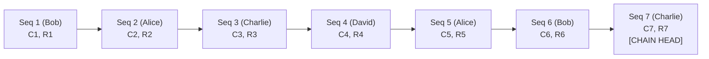

# Milestone 11 Design: Bulk Export with Independent Verification (Refined)

**Project:** Charles Schwab FDE — Audit Log Service
**Milestone:** 11 (Scenario B: Verifiable Bulk Export)
**Status:** Approved Design Refinement
**Baseline Commit:** `36521b1` (Milestone 10: Structured Payload Redaction)

---

## Executive Summary

Scenario B of the Charles Schwab FDE assessment mandates:
> *"Bulk Export: Provide an endpoint to export all records for a given `resourceId` or `actorId` as a self-contained, verifiable bundle. The bundle must include enough chain metadata for a recipient to independently verify the records it contains have not been altered since export."*

When an audit log is filtered by an attribute such as `resourceId` or `actorId`, the resulting events are **non-contiguous** within the global append-only chain (e.g., sequence numbers 2, 7, and 19). Because each event's `record_hash` commits to the immediate predecessor's `record_hash` ($R_i = \text{SHA-256}(\dots, R_{i-1}, \dots)$), an export containing only the matching records breaks the recipient's ability to recalculate the chain linkage between sequence 2 and sequence 7.

This document specifies the refined architectural design for **Milestone 11**, incorporating explicit security boundaries, snapshot guarantees, privacy analysis, and synthesis across milestones:
1. **Self-Contained Verifiable Bundle (`bundleVersion: "1.0"`)**: Providing matched event records with full canonical payloads alongside a compact, privacy-preserving **witness chain** (intermediate `sequenceNo`, `previousHash`, `contentHash`, `recordHash`) that cryptographically bridges all sequence gaps from genesis ($0^{64}$) to the observed `chainHead`.
2. **Relative vs. Absolute Trust Anchors**: Explicitly clarifying that the bundle's `chainHead` is a point-in-time server commitment; independent trust against history rewriting requires an out-of-band external anchor or notarization.
3. **Inclusion / Integrity vs. Completeness Boundary**: Cryptographically proving **authenticity and tamper-evidence** of all included records, while documenting the theoretical boundary that sparse chains cannot prove non-omission without disclosing third-party payloads or employing zero-knowledge proofs.
4. **Privacy Analysis of Witness Hashes**: Proving that exposing intermediate SHA-256 hashes ($C_i, R_i$) discloses zero plaintext, and showing how high entropy in canonical metadata protects against dictionary attacks.
5. **Cross-Milestone Synthesis (Archival & Redaction)**: Preserving immutable ledger rows for soft-archived events (Milestone 9) and crypto-shredded envelopes (Milestone 10), ensuring 100% hash recalculation pass with zero sensitive plaintext leakage.
6. **Deterministic Serialization & Snapshot Isolation**: Ensuring deterministic export generation using PostgreSQL snapshot transactions and RFC 8785 canonicalization.
7. **Offline Standalone Verifier**: Providing a zero-dependency standalone verification script (`scripts/verify_export.py`) alongside an embedded Java verifier for automated test suites.

---

## 1. Problem Analysis & Cryptographic Foundations

### 1.1 The Hash Chain Invariant
In our service, every event $i$ committed to `audit_event` satisfies two mathematical commitments:
1. **Canonical Content Hash ($C_i$)**:
   $$C_i = \text{SHA-256}\big(\text{JCS-1}(\text{actorId}, \text{canonicalizationVersion}, \text{eventId}, \text{eventType}, \text{payload}, \text{recordedAt}, \text{resourceId}, \text{resourceType}, \text{sourceTimestamp})\big)$$
2. **Domain-Separated Record Hash ($R_i$)**:
   $$R_i = \text{SHA-256}\big(\text{LenPrefixed}(\text{"AUDIT\_RECORD\_V1"}) \parallel \text{LenPrefixed}(i) \parallel \text{LenPrefixed}(R_{i-1}) \parallel \text{LenPrefixed}(C_i)\big)$$
   where $R_0 = 0^{64}$ (64 lowercase ASCII zeros).

### 1.2 The Dilemma of Filtered Exports
Suppose the ledger contains events $1, 2, 3, 4, 5, 6, 7$, and an auditor requests all records for `actorId = "alice"`.
Suppose Alice generated events at sequences **2** and **5**:



If the export endpoint returned only $\{ \text{Event } 2, \text{Event } 5 \}$:
- The recipient can recompute $C_2$ and $R_2$ (using $R_1 = \text{Event } 2.\text{previousHash}$).
- However, Event 5 has $\text{previousHash} = R_4$.
- The recipient **cannot verify** whether $R_4$ was honestly derived from $R_2$, because events 3 and 4 are missing!
- An attacker who intercepted the export could fabricate a fake Event 5 with arbitrary payload and arbitrary `previousHash` $R_4$, and the recipient would have no mathematical means to detect the forgery.

### 1.3 Architectural Options for Verifiability

| Approach | Description | Verifiability | Confidentiality | Bandwidth / Complexity | Recommendation |
| :--- | :--- | :--- | :--- | :--- | :--- |
| **Option 1: Isolated Sub-Chain (Re-hashing)** | Re-hash matching records into a new localized synthetic chain $(E_2 \rightarrow E_5)$. | Weak: Does not prove the records were ever part of the authoritative global audit ledger. | High | Very low | **Rejected**: Fails the assessment requirement ("include enough chain metadata to verify records have not been altered since export"). |
| **Option 2: Signed Standalone Manifest** | Server signs the list of matching records with an RSA/ECDSA private key. | Relies on server key trust, not hash-chain integrity. | High | Low | **Rejected**: Assessment specifically tests hash-chain verification and tamper evidence. |
| **Option 3: Genesis-to-Head Sparse Chain with Hash Witnesses** | Full payloads for matched events, plus intermediate **witness nodes** $(\text{sequenceNo}, \text{previousHash}, \text{contentHash}, \text{recordHash})$ for non-matched events from genesis ($0^{64}$) to head. | **Complete**: Recipient recalculates all record hashes from genesis to the observed chain head. | **Total**: Witness nodes disclose only SHA-256 hashes ($C_i, R_i$); zero sensitive payloads, actors, or resources of third parties are exposed. | Moderate: Hashes are 64 hex characters (~220 bytes per witness); easily fits within response limits for typical ledgers. | **APPROVED & MANDATED** |

---

## 2. Rigorous Security & Trust Boundaries

### 2.1 Chain-Head Checkpoint Trust Boundary
A critical engineering question is: **Is the bundle's `chainHead` automatically an independently trusted or latest checkpoint?**

- **Answer: No.** The `chainHead` included in the bundle reflects the internal database's committed state (`last_sequence_no`, `last_record_hash`) at the moment the export snapshot was created.
- **Internal Relative Guarantee**: The bundle mathematically proves that the exported events are consistent with *that specific chain head*. Any subsequent tampering with an event's payload, timestamp, sequence, or intermediate hash breaks the path to `chainHead.recordHash`.
- **External Absolute Trust Limitation**:
  - The export bundle alone cannot prove to an external recipient that the declared `chainHead` is the *globally latest* head, or that a malicious server operator with database root access did not roll back the database or fork a private ledger branch.
  - To achieve **absolute external non-repudiation**, the recipient must compare `chainHead.recordHash` against an independently notarized checkpoint, such as:
    1. A signed witness log or transparency log checkpoint.
    2. A previous export bundle received by the same auditor (where sequence numbers must be monotonically non-decreasing and historical hashes must match).
    3. An external timestamping service or public key-signed digest.

### 2.2 Event Integrity & Inclusion vs. Result Completeness
We explicitly separate two cryptographic properties:

1. **Proof of Inclusion & Tamper Evidence (Guaranteed & Verifiable)**:
   - For every record in `events`, the recipient independently recomputes the RFC 8785 canonical content hash $C_i$ and the record hash $R_i$.
   - By traversing the witness chain, the recipient verifies that $R_i$ is linked into the unbroken sequence from genesis ($0^{64}$) up to `chainHead.recordHash`.
   - Any modification of a matched record's payload, actor, resource, timestamp, or sequence number breaks the mathematical link and is detected.

2. **Proof of Completeness / Non-Omission (Documented Theoretical Boundary)**:
   - Can the recipient prove that the server did not omit an event for Alice at sequence 4 by disguising it as a witness node?
   - **No.** Witness node 4 contains $(C_4, R_4)$ without disclosing `actorId` or payload. The recipient cannot determine whether sequence 4 belonged to David or Alice.
   - Disclosing sequence 4's `actorId` or payload to Alice would violate David's confidentiality and privacy rights.
   - *Conclusion*: A sparse hash-chain export guarantees **authenticity, tamper-evidence, and chain inclusion**, but cannot prove negative non-omission without zero-knowledge set-membership proofs or full-ledger disclosure. This boundary is explicitly documented.

### 2.3 Privacy Analysis of Intermediate Witness Hashes
What are the privacy implications of exposing intermediate hashes, and what is the minimum witness metadata required?

1. **Minimum Metadata Required**:
   - `sequenceNo`: Proves sequence contiguity ($k = k_{\text{prev}} + 1$).
   - `previousHash`: Binds to the preceding record hash ($R_{k-1}$).
   - `contentHash`: **Strictly required** to recalculate the domain-separated record hash:
     $$R_k = \text{SHA-256}\big(\text{LenPrefixed}(\text{"AUDIT\_RECORD\_V1"}) \parallel \text{LenPrefixed}(k) \parallel \text{LenPrefixed}(R_{k-1}) \parallel \text{LenPrefixed}(C_k)\big)$$
     Without $C_k$, the recipient could not recalculate $R_k$ and would be forced to trust the server's asserted $R_k$, completely defeating independent verifiability!
   - `recordHash`: Binds to the succeeding record's `previousHash`.

2. **Pre-Image & Dictionary Attack Analysis**:
   - SHA-256 is cryptographically one-way (pre-image resistant). Knowing $C_k$ does not reveal the payload.
   - *Dictionary Attack Risk*: If an event payload has very low entropy (e.g. `{ "active": true }`), an attacker with knowledge of the schema could attempt to brute-force $C_k$.
   - *Mitigation in Audit Log Service*: In our architecture, the canonical JSON object covers 9 fields, including:
     - Globally unique UUID `eventId` (122 bits of CSPRNG entropy).
     - Microsecond/millisecond UTC timestamp `recordedAt`.
     - Decimal sequence number `sequenceNo`.
   - Because `eventId` and `recordedAt` are unique and high-entropy, the input space for $C_k$ exceeds $2^{128}$, making dictionary attacks mathematically infeasible. Witness hashes reveal zero sensitive plaintext.

---

## 3. Cross-Milestone Synthesis: Archival & Redaction

### 3.1 Synthesis with Milestone 9 (Soft Archival)
- **Requirement**: The assessment states "export all records for a given `resourceId` or `actorId`".
- In Milestone 9, records are soft-archived by creating a row in `audit_event_archive` without mutating rows in `audit_event`.
- In the export bundle:
  - Both active and soft-archived records matching the filter are exported by default (`includeArchived = true`).
  - For soft-archived records, the `archivedAt` timestamp is populated from `audit_event_archive`.
  - Stored `content_hash` and `record_hash` in `audit_event` are identical to their creation state, ensuring 100% hash verification pass.

### 3.2 Synthesis with Milestone 10 (Structured Redaction)
- **Category 2 (Crypto-Shredded AES-256-GCM Envelopes)**:
  - In Milestone 10, sensitive fields are stored as `EncryptedEnvelope` objects (`keyId`, `ciphertext`, `iv`, `algorithm`).
  - When redacted, `KeyManager.destroyKey(keyId)` permanently erases the DEK.
  - The stored `payload` in `audit_event` retains the encrypted envelope (ciphertext).
  - **Export Verifiability**: The export bundle includes the original canonical envelope payload. The recipient recomputes the canonical JCS-1 content hash over the ciphertext envelope and verifies the hash chain cleanly.
  - **Data Privacy**: Because the DEK was destroyed in the KMS / KeyManager, the ciphertext is indecipherable ($2^{256}$ keyspace). Zero sensitive plaintext is disclosed.
- **Category 1 (Legacy Masked Records)**:
  - For legacy plaintext events where projection masking was applied, the export bundle outputs the projected masked payload (`"[REDACTED]"`).
  - The bundle marks the event with `redactionType: "MASKED"`.
- **Meta-Audit Verification**:
  - In Milestone 10, every redaction appends an immutable `PAYLOAD_REDACTED` event to `audit_event`.
  - When exporting by `resourceId`, the `PAYLOAD_REDACTED` meta-events for that resource are naturally returned as matched events! The recipient can verify the meta-audit event directly on the chain as legal proof of authorized erasure.

---

## 4. Deterministic Export Generation & Database Snapshots

To guarantee that export bundles are completely deterministic and free of race conditions during concurrent appends:

1. **Consistent Snapshot Isolation**:
   - The export service executes under `@Transactional(readOnly = true)`.
   - At the beginning of the transaction, the service queries `audit_chain_head` to record the observed snapshot head: `(snapshotHeadSeq, snapshotHeadHash)`.
   - All subsequent queries for matched events and witness records filter by `sequence_no <= snapshotHeadSeq`.
   - This ensures that concurrent appends advancing the chain head during export generation do not produce dangling witness links or phantom events beyond the declared `chainHead`.

2. **Deterministic Sequence Ordering**:
   - All event queries and witness queries enforce explicit `ORDER BY sequence_no ASC`.
   - Result lists are processed monotonically, eliminating non-deterministic iteration order.

3. **Deterministic RFC 8785 (JCS) Serialization**:
   - Event canonicalization uses `java-json-canonicalization:1.1`, sorting all JSON object keys by UTF-16 code units per RFC 8785 §3.2.3.
   - Timestamps are formatted with UTC millisecond precision (`yyyy-MM-dd'T'HH:mm:ss.SSS'Z'`).

---

## 5. API Contract Specification (`GET /audit/exports`)

### 5.1 Endpoint Overview
- **HTTP Method**: `GET`
- **Path**: `/audit/exports`
- **Authorization**: HTTP Basic Auth with role `AUDITOR`
- **Produces**: `application/json`

### 5.2 Query Parameters

| Parameter | Type | Required | Default | Validation & Rules |
| :--- | :--- | :--- | :--- | :--- |
| `actorId` | String | Conditional | `null` | Export all events matching `actor_id = ?`. Mutually exclusive with `resourceId`. Must not be blank. |
| `resourceId` | String | Conditional | `null` | Export all events matching `resource_id = ?`. Mutually exclusive with `actorId`. Must not be blank. |
| `includeArchived` | Boolean | Optional | `true` | When `true`, exports both active and soft-archived events (with `archivedAt` populated). Default is `true`. |

#### Strict Validation Rules:
1. **Missing Filter**: If neither `actorId` nor `resourceId` is provided $\rightarrow$ HTTP 400 Bad Request (`"Either 'actorId' or 'resourceId' must be provided."`).
2. **Conflicting Filters**: If both `actorId` and `resourceId` are provided $\rightarrow$ HTTP 400 Bad Request (`"Parameters 'actorId' and 'resourceId' are mutually exclusive; provide exactly one."`).
3. **Blank Filter**: If the provided filter contains only whitespace $\rightarrow$ HTTP 400 Bad Request (`"'actorId' must not be blank."` or `"'resourceId' must not be blank."`).

### 5.3 Versioned JSON Schema (`ExportBundleDto`)

```json
{
  "bundleVersion": "1.0",
  "exportId": "3b29c5a1-7e84-4822-b5e1-0c58e1d28394",
  "exportedAt": "2026-10-15T14:00:00.123Z",
  "filter": {
    "filterType": "ACTOR_ID",
    "filterValue": "actor-123",
    "includeArchived": true
  },
  "chainHead": {
    "sequenceNo": 50,
    "recordHash": "8f3a1b4c9e2d0f5a7b6c8d1e3f5a7b9c1d3e5f7a9b1c3d5e7f9a1b3c5d7e9f1a"
  },
  "summary": {
    "matchedEventsCount": 2,
    "firstMatchedSequenceNo": 2,
    "lastMatchedSequenceNo": 45,
    "witnessCount": 48
  },
  "events": [
    {
      "sequenceNo": 2,
      "eventId": "00000000-0000-0000-0000-000000000002",
      "eventType": "ORDER_PLACED",
      "actorId": "actor-123",
      "resourceType": "ORDER",
      "resourceId": "order-999",
      "payload": {
        "orderId": "order-999",
        "symbol": "SCHW",
        "quantity": 100
      },
      "sourceTimestamp": "2026-10-15T13:45:00.000Z",
      "recordedAt": "2026-10-15T13:45:01.456Z",
      "canonicalizationVersion": "JCS-1",
      "contentHash": "e3b0c44298fc1c149afbf4c8996fb92427ae41e4649b934ca495991b7852b855",
      "previousHash": "4a5b6c7d8e9f0a1b2c3d4e5f6a7b8c9d0e1f2a3b4c5d6e7f8a9b0c1d2e3f4a5b",
      "recordHash": "1a2b3c4d5e6f7a8b9c0d1e2f3a4b5c6d7e8f9a0b1c2d3e4f5a6b7c8d9e0f1a2b",
      "archivedAt": null
    }
  ],
  "witnesses": [
    {
      "sequenceNo": 1,
      "previousHash": "0000000000000000000000000000000000000000000000000000000000000000",
      "contentHash": "9f8e7d6c5b4a3f2e1d0c9b8a7f6e5d4c3b2a1f0e9d8c7b6a5f4e3d2c1b0a9f8e",
      "recordHash": "4a5b6c7d8e9f0a1b2c3d4e5f6a7b8c9d0e1f2a3b4c5d6e7f8a9b0c1d2e3f4a5b"
    }
  ]
}
```

---

## 6. Standalone Verification Tooling (`scripts/verify_export.py`)

A production-grade Python 3 script will be provided at `scripts/verify_export.py` with zero external dependencies, implementing:
1. Schema and contiguity validation from sequence 1 to `chainHead.sequenceNo`.
2. RFC 8785 JSON canonicalization and SHA-256 content hash recalculation.
3. Length-prefixed domain-separated SHA-256 record hash recalculation:
   $$R_k = \text{SHA-256}\big(\text{len}(\text{"AUDIT\_RECORD\_V1"}) \parallel \text{"AUDIT\_RECORD\_V1"} \parallel \text{len}(k) \parallel k \parallel \text{len}(R_{k-1}) \parallel R_{k-1} \parallel \text{len}(C_k) \parallel C_k\big)$$
4. Final alignment check against `chainHead.recordHash`.
5. Filter compliance assertion for every matched event.

---

## 7. Implementation Plan & Reviewable Steps

1. **Step 1: DTOs & Domain Model** (`com.example.auditlog.export`):
   - `ExportBundleDto`, `ExportEventDto`, `ExportWitnessDto`, `ExportFilterCriteria`, `ExportSummaryDto`.
2. **Step 2: Service Layer (`AuditExportService`)**:
   - Snapshot read transaction: query chain head, partition records into `events` and `witnesses`, assemble bundle.
3. **Step 3: Controller Layer (`AuditExportController`)**:
   - `GET /audit/exports` with strict parameter validation and error mapping.
4. **Step 4: Security Configuration**:
   - Authorize `GET /audit/exports` for `AUDITOR`.
5. **Step 5: Standalone Verifiers**:
   - Java test verifier `StandaloneExportVerifier`.
   - Standalone script `scripts/verify_export.py`.
6. **Step 6: Comprehensive Testing**:
   - Filter validation, security authorization, tamper detection (payload, sequence, witness, head), soft-archival integration, redaction integration, concurrent appends, completeness boundary test.
7. **Step 7: Documentation & Verification**:
   - Update architecture, requirements, test backlog, and AI usage logs.
   - Run `mvn clean test` and `git diff --check`.
